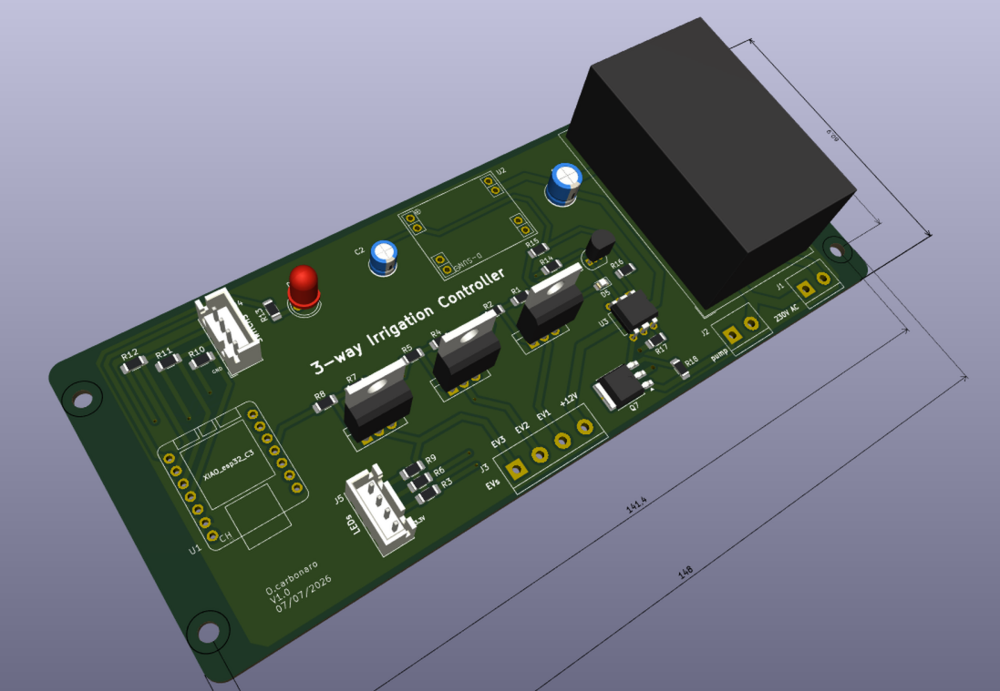
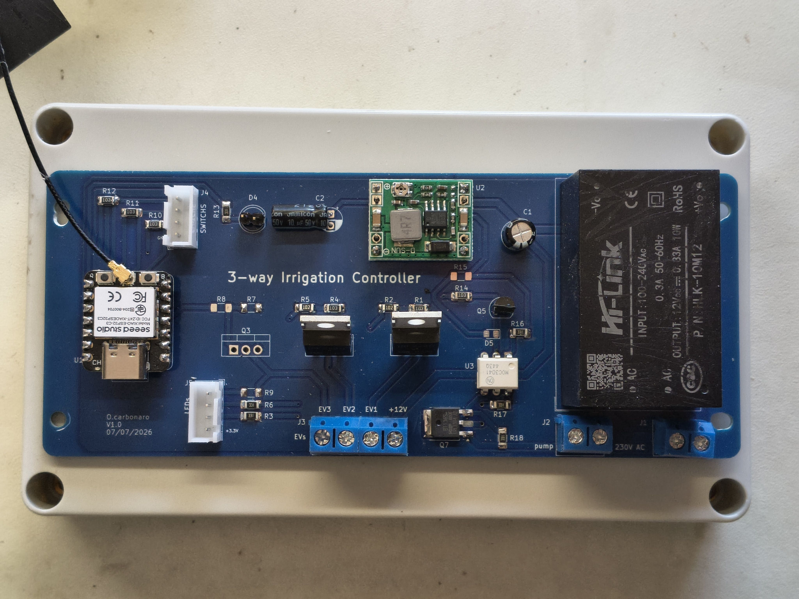
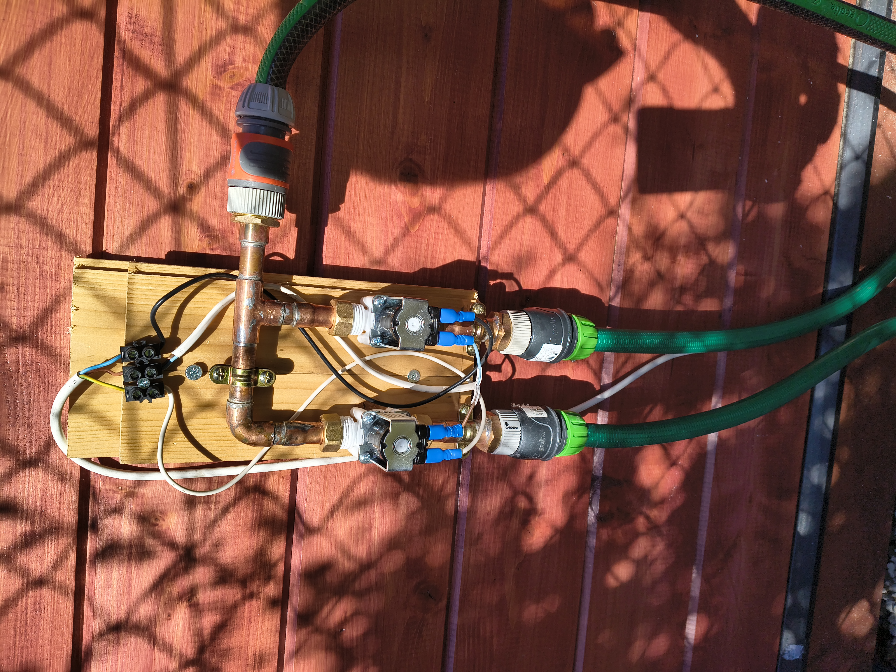
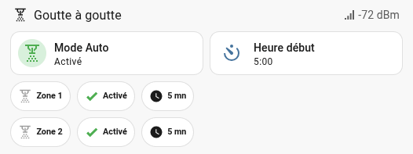

# irrigation_controller

## Overview
This controller is used to remotely control a drip irrigation system.  

It controls up to 3 irrigation zones and, optionally, a submersible pump.

Home Assistant controls the watering sequences:
- activation of the irrigation controller, programmable start time of the irrigation sequence
- behavior of each zone (availability and watering duration)  

## Features
### On the irrigation controller
- water inlet: one 3/4" connection, on the right side
- water outlets: 1, 2, or 3 × 3/4" connections, facing downward
- for each outlet:
    - a manual control button (all 3 valves can be opened at the same time)
    - a LED that lights up when the valve is open
- a safety timeout turns off the valves after _EV_timeout_ minutes of activation
- the status LED blinks when WiFi is connected
- the controller is powered from 230 V AC

### In Home Assistant
A button makes the controller active (watering according to the zone parameters) or inactive (no watering).

Start time: HH:MM [0:00 to 23:59], when the watering sequence shall start.

The behavior of each zone is defined in Home Assistant with the following parameters:
- availability: true if the zone is used, false if it is not used
- days of week: frequency of watering _(to be added)_
- duration: watering duration in minutes [1 to 15]
- frequency: 1 cycle (every 24h), 2 cycles (every 12h), 3 cycles (every 6h) _(to be added)_
- a button to manually operate the zone (immediate start on the 1st push, immediate stop on the 2nd push)  
- rain sensor: disables the watering sequence while it is raining _(to be added)_

Sequence definition: at the start time, zone 1 is operated for the given duration if it is activated, then zone 2, then zone 3.

## Hardware
### Electronics

Schematic & PCB designed using KiCad 9

- Microcontroller: Seeed Studio XIAO ESP32-C3
- 12 V solenoid valve control: power MOSFET IRFZ24N (55 V, 17 A)
- Submersible pump control: 230 V Triac BT136-600

**Final design**
PCB dimensions 148 × 61 mm, 4 mounting holes (141.4 × 45 mm)

**Various configurations are available**
a) 2 valves + 1 pump  

The D5 LED (= TRIAC is active) is optional.

b) 3 valves, no pump  
Yet to come

### Hydraulic
- Inlet: 3/4" (20/27) for an automatic garden connection
- Outlet: 3/4" (20/27) for an automatic garden connection
- solenoid valves: 12 V DC, NC, 0.02 - 0.8 MPa, 1/2" (15/21) solenoid valve, from a washing machine
- 14 mm copper pipes

## Firmware
- The ESP32 module manages
    - the GPIOs
    - a script to drive the solenoid valves and the submersible pump
    - a safety timeout to stop watering in case HA is disconnected during a watering sequence
- HA manages the irrigation sequences and the manual control through a card in the "garden" dashboard

### ESPHome firmware
binary sensor:  
- SW3, SW2, SW1 (must be high at boot): manual command on the device
- ev1_active, ev2_active: provide HA with the actual status of the solenoid valves

switch: ON/OFF command
- EV1, EV2, EV3: commands for the 3 solenoid valves
- pump control: submersible pump command

output:
- status LED (HIGH side command)

sensor:
- WiFi RSSI in dBm

button:  
- 3 virtual buttons to manually control EV1, EV2 and EV3 in HA

wifi:
- automatically connects to any of the 3 WiFi routers in the home

light:
(The binary light platform creates a simple ON/OFF-only light from a binary output component.)
- **led_status**: blinks the status LED according to LED_ON (100 ms) and LED_OFF (4900 ms)  

script:
- **toggle_EV1, toggle_EV2, toggle_EV3**: turn the given solenoid valve on and off; turn on the submersible pump when at least one valve is on, and turn it off when all valves are off; launch the safety timeout  
- **valves_safety_timeout**: turns off every command after EV_timeout (typically 30 min)  

### Home Assistant configuration

All the elements linked to the irrigation controller are found under the label "irrigation".

#### Device
- add "irrigation_ctl1" under Settings → Devices & Services → ESPHome

#### Entities
The actionable entities are:
- EVi command: executes the script `toggle_EVi`
- pump: `switch_toggle` pump
- EVi: `switch_toggle` solenoid valve i

#### Helpers
- common to all zones:
  - `irrigation_auto`: enables the automatic watering program
  - `irrigation_heure_debut` (watering start time): the time at which watering starts
- for each zone (i = 1, 2 or 3):
  - `irrigation_active_zonei`: enables the watering program on zone i
  - `irrigation_duree_zonei` (watering duration zonei): the watering duration of zone i

#### Script
- `lancer_goutteAgoutte_1` (run drip irrigation): executes `commande_EVi` if `irrigation_active_zonei` is true, for the duration `irrigation_duree_zonei`

#### Automation
- `Démarrage irrigation` (Start irrigation): at `irrigation_heure_debut`, executes the script `lancer_goutteAgoutte_1` if `irrigation_auto` is set to true

#### Dashboard
a) 2 valves version, french language
- Mode Auto ('Auto mode'): makes the controller active (watering according to the zone parameters) or inactive (no watering)
- Heure Début ('Start time'): the start time of the watering sequence
- Zone 1, Zone 2: a single click manually starts the watering of the selected zone. A second click stops the watering. While watering is on, the icon turns red.
- Activé/desactivé ('Enabled/Disabled'): if enabled, the zone is included in the watering sequence
- Duration: automatic watering duration, from 1 min to 15 min  

