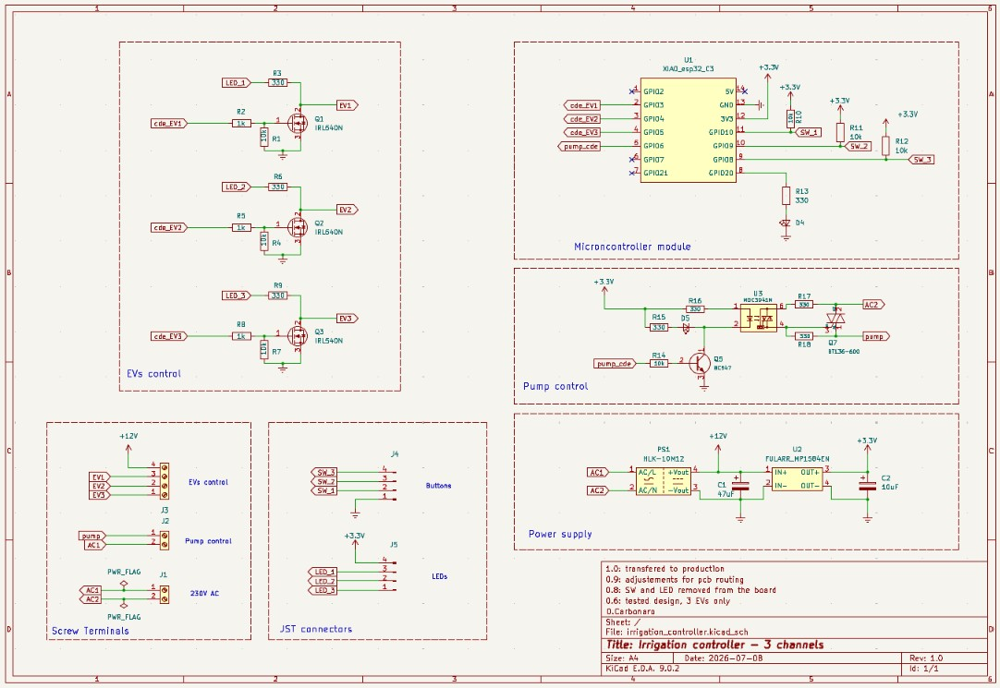
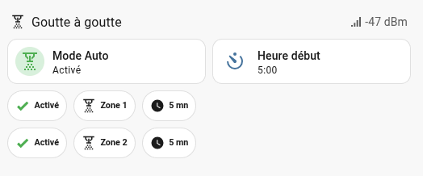

# irrigation_controller

## Overview
This controller is used to remotely control a drip irrigation system.  

It controls up to 3 irrigation zones and optionnally a submersible pump

Home Assistant controls the watering sequences
- activation of the irrigation controller, programmable start time of the irrigation sequence 
- behavior of each zone(availaibility and watering duration)  

## Features
### On the irrigation controller: 
- water inlet : one 3/4" connection, on the right side
- water outlets : 1, 2 or 3 3/4" connections,  facing downward
- for each outlet:
    - a manual control button (all 3 valves can be opened at the same time)
    - a LED that lights up when the valve is open
- a security timeout turns off valves after _EV_timeout_ minutes of activation
- status LED blinks when WiFi is connected
- controller is AC 230V powered 

### In Home assistant:
A button makes the controller active (watering according to zone parameters) or inactive (no watering)
Start_time : HH/MM [0:00 to 23:59] when the watering sequence shall start
The behavior of each zone is defined in Home Assistant with the following parameters:
- availability: true if zone is used, false if not used
- days of week: frequency of watering _(to be added)_
- duration: duration in mn [1 to 15] of the watering
- frequency: 1 cycle (every 24h), 2 cycles (every 12h), 3 cycles (every 6h)_(to be added)_
- a button to manually operate the zone (immediate start on 1st push, immediate stop on 2nd push)  
- pluviometer: disable the watering sequence when raining _(to be added)_

Sequence definition : at start time, zone 1 is operated for the given duration if activated, then zone 2, then zone 3

## Hardware
### Electronic

Schematic & Pcb design using KiCad 9

- Microcrontroller: Seeed Studio XIAO esp32-C3
- 12 solenoid valve control: power MOSFET IRFZ24N (55V 17A)
- Submerged pump control: 230V Triac BT136-600

**Final design**
Pcb dimensions 148 x 61 mm, 4 mounting holes (141,4 x 45 mm)

**Various configurations are available**
a) 2 valves + 1 pump  

D5 LED (= TRIAC is active) is optionnal 

b) 3 valves, no pump  
Yet to come

### Hydraulic
- Inlet : 3/4" (20/27) for automatic garden connection
- Output : 3/4"  (20/27) for automatic garden connection
- solenoid valves : 12V DC NC, 0.02 - 0.8 MPa, 1/2" (15/21) solenoid valve, from washing machine
- 14 mm copper pipes

## Firmware
- esp32 module manages 
    - gpios 
    - a script to drive solenoid valves and the submerged pump
    - a safety timeout to stop watering in case HA is disconnected during a watering sequence
- HA manage irrigations sequences and manual control through a card in the "garden" dashboard

### ESPHome firmware
binary sensor:  
- SW3, SW2, SW1 (must be high at boot) : manual command on the device
- ev1_active, ev2_active: provides HA with actual status of the solenoid valves

switch:  ON/OFF command 
- EV1, EV2, EV3  : the 3 solenoid valves command
- pump control  : submerged pump command

output:
- status LED  (HIGH side command)

sensor:
- WiFi RSSI in dBm

button:  
- 3 virtual buttons to manually control EV1, EV2 and EV3 in HA 

wifi : 
- automatically connects to the 3 possible WiFi routers of the home

light:
(The binary light platform creates a simple ON/OFF-only light from a binary output component.)
- **led_status**: blinks the status LED according to LED_ON (100 ms) and LED_OFF (5000 ms)  

script :
- **toggle_EV1, toggle_EV2, toggle EV3**: turn on and off the given solenoid valve ; turn on immerged pump when at least one valve is on, and off when all valves are off ; launch security timeout  
- **valves_security_timeout**: turns off every command after EV_timeout (typically 30mn)  

### Home Assistant configuration

All elements linked to the irrigation controller are found under the label "irrigation"

#### Device
- add "irrigation_ctl1" in appareils & service /ESPHome"

#### Entities
Actionnable entities are 
- EVi command: execute script toggle_EVi
- pump: switch_toggle pump
- EVi: switch_toggle solenoid valve i

#### Helpers
- common to all zones:
        - irrigation_auto: to enable the automatic watering program
        - irrigation_heure_debut: watering start time
- for ach zone (i = 1, 2 or 3)
        - irrigation_active_zonei: to enable watering progm on zone i
        - irrigation_duree_zonei: watering suration of zone i

#### script
- lancer_goutteAgoutte_1: execute "commande_EVi" if "irrigation_active_zonei" is true for "irrigation_duree_zonei"

#### automation
- Démarrage irrigation : at "irrigation_heure_debut", execute script "lancer_goutteAgoutte_1" if "irrigation_auto" set to true

#### dashboard
a) 2 valves version
-  Mode Auto : makes the controller active (watering according to zone parameters) or inactive (no watering)
- Heure Debut : start time of the xatering sequence
- Zone 1, Zone 2 : a click manually start the watering of the selected zone. A second click stop the watering. When watering is on, the icon changes to color red.
- Activé/Desactivé: if activated, the zone will be selected in the waterng sequence
- Duration : automatic watering duration from 1mn to 15mn

